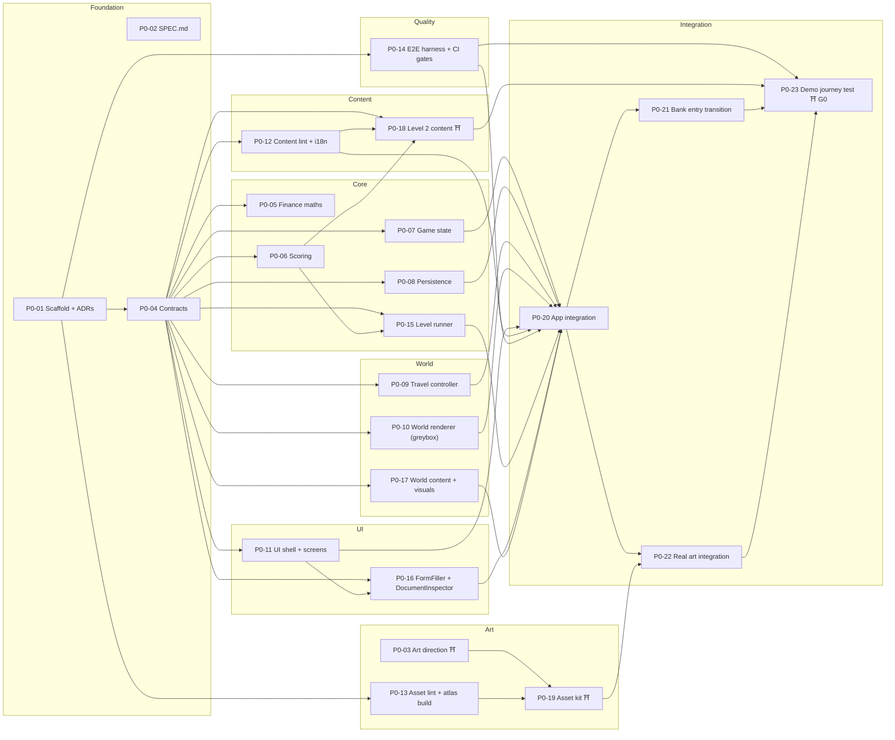
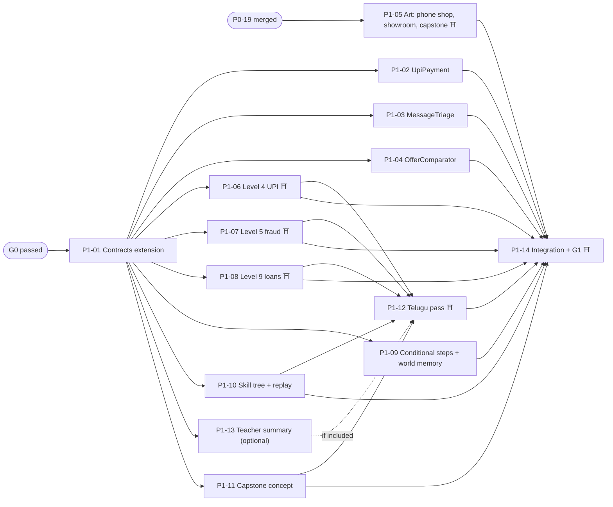
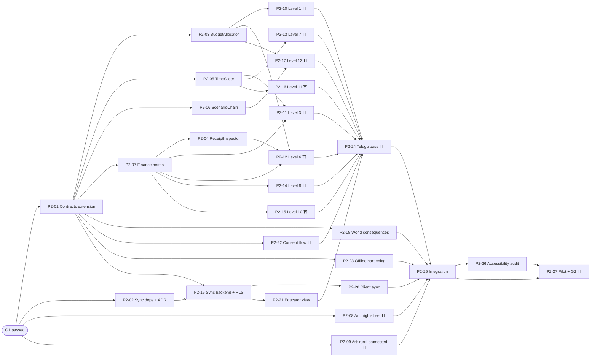

# Task breakdown — Paisa Street

Source: [`docs/technical-implementation-plan.md`](../technical-implementation-plan.md). Each task is one Orca card = one worktree = one agent = one PR (see `docs/orca-kit/15-work-division-and-delegation.md`). Every brief in `P0/`, `P1/` and `P2/` follows `templates/TASK-BRIEF.md` and can be pasted as the `--prompt` of `orca-ide worktree create`.

## Rules that make the parallel split safe

1. **Interfaces first.** `P0-04` lands all shared types and Zod schemas in `src/core/contracts/`. After it merges, the contracts are frozen for the wave; a change needs its own small PR approved by the coordinator.
2. **Dependencies frozen.** `P0-01` installs every P0 dependency and writes the ADRs. No other P0 task edits `package.json` or the lockfile.
3. **Disjoint ownership.** No two tasks that can run at the same time own the same path. The "Owns" column is the full list of paths a task may edit.
4. **Registries have one writer.** `src/ui/interactions/index.ts` and `src/content/levels/index.ts` are created empty by `P0-04` and filled by exactly one task per phase (`P0-16`/`P0-18` in P0, `P1-14` in P1, `P2-25` in P2).
5. **Per-task files.** Each level owns `src/content/levels/<id>/` (level, sources). Every task that adds player-facing text owns its own string namespace, `src/content/locales/{en,te}/<namespace>.json` (`common` belongs to P0-12; `ui` to P0-11; `interactions` to P0-16; `world` to P0-17; `app` to P0-20; one per level), so no two tasks edit the same strings file.
6. **Human gates** are marked ⛩ and block downstream tasks until the named person signs off in the PR.
7. **Orca runs stay shallow.** Each run below has a dependency depth of 3 or less.

## P0 — Playable slice

| ID | Task | Depends on | Owns (may edit) | Agent fit |
| --- | --- | --- | --- | --- |
| [P0-01](P0/P0-01-scaffold.md) | Scaffold, toolchain, stack ADRs | — | `package.json`, lockfile, root configs, `src/main.tsx`, `.github/workflows/ci.yml`, `docs/adr/`, tool stubs | Strong reasoning |
| [P0-02](P0/P0-02-spec.md) | SPEC.md from the product plan | — | `SPEC.md`, `docs/product-plan.md` | Strong reasoning |
| [P0-03](P0/P0-03-art-direction.md) | Art direction and art bible ⛩ | — | `art/bible/` | PixelLab MCP + product owner |
| [P0-04](P0/P0-04-contracts.md) | Contracts and schemas | P0-01 | `src/core/contracts/`, empty registries | Strong reasoning |
| [P0-05](P0/P0-05-finance.md) | Finance maths | P0-04 | `src/core/finance/` | Fast |
| [P0-06](P0/P0-06-scoring.md) | Scoring rubric and review items | P0-04 | `src/core/scoring/` | Strong reasoning |
| [P0-07](P0/P0-07-state.md) | Game state: reducer, derive, merge, migrations | P0-04 | `src/core/state/` | Strong reasoning |
| [P0-08](P0/P0-08-persistence.md) | IndexedDB persistence | P0-04 | `src/persistence/` | Fast |
| [P0-09](P0/P0-09-travel-controller.md) | Travel controller | P0-04 | `src/input/` | Strong reasoning + real phone |
| [P0-10](P0/P0-10-world-renderer.md) | World renderer, greybox | P0-04 | `src/world/` | Strong reasoning |
| [P0-11](P0/P0-11-ui-shell.md) | UI shell, tokens, screens | P0-04 | `src/ui/` except `src/ui/interactions/` | pen.dev or Stitch MCP |
| [P0-12](P0/P0-12-content-tooling.md) | Content lint, sources, i18n | P0-04 | `tools/content-lint/`, `src/content/sources.ts`, `src/i18n/`, `src/content/locales/*/common.json` | Fast |
| [P0-13](P0/P0-13-asset-lint.md) | Asset lint and atlas build | P0-01 | `tools/asset-lint/`, `tools/assetpack/`, `art/README.md` | Fast |
| [P0-14](P0/P0-14-e2e-harness.md) | E2E harness and CI quality gates | P0-01 | `playwright.config.ts`, `tests/e2e/harness/`, `tests/privacy/`, `lighthouserc.json`, `.github/workflows/e2e.yml` | Fast |
| [P0-15](P0/P0-15-level-runner.md) | Level runner | P0-04, P0-06 | `src/level-runner/` | Strong reasoning |
| [P0-16](P0/P0-16-interactions-bank.md) | FormFiller and DocumentInspector | P0-04, P0-11 | `src/ui/interactions/` | Fast |
| [P0-17](P0/P0-17-world-content.md) | World content and world visuals | P0-04 | `src/content/world.ts`, `src/content/skillTree.ts`, `src/core/worldVisuals/` | Fast |
| [P0-18](P0/P0-18-level-02.md) | Level 2 content ⛩ | P0-04, P0-06, P0-12 | `src/content/levels/l02/`, `src/content/levels/index.ts`, `src/content/locales/*/l02.json` | Strong reasoning + NGO educator |
| [P0-19](P0/P0-19-asset-kit.md) | Asset kit generation ⛩ | P0-03, P0-13 | `art/raw/`, `art/approved/` | PixelLab MCP + product owner |
| [P0-20](P0/P0-20-app-integration.md) | App integration | P0-07, 08, 09, 10, 11, 12, 14, 15, 16, 17 | `src/app/`, `src/main.tsx`, `tests/e2e/fixtures/` | Strong reasoning |
| [P0-21](P0/P0-21-bank-transition.md) | Bank entry transition and arrival cue | P0-20 | `src/transitions/`, `src/app/transitions.ts` | Strong reasoning + real phone |
| [P0-22](P0/P0-22-real-art.md) | Real art integration | P0-19, P0-20 | `src/world/assets/`, `src/app/textures.ts`, `public/assets/` | Fast |
| [P0-23](P0/P0-23-demo-journey.md) | Demo journey test, gate G0 ⛩ | P0-14, 18, 21, 22 | `tests/e2e/demo-journey.spec.ts`, `tests/visual/` | Fast + product owner |

### P0 Orca runs

| Run | Tasks | Max parallel agents |
| --- | --- | --- |
| 1 | P0-01, P0-02, P0-03 | 3 |
| 2 | P0-04 (P0-03 continues) | 2 |
| 3 | Wave A: P0-05 to P0-14, P0-17 · Wave B as each parent merges: P0-15, P0-16, P0-18, P0-19 | 11 |
| 4 | P0-20 → {P0-21, P0-22} → P0-23 | 2 |

The code critical path is P0-01 → P0-04 → P0-06 → P0-15 → P0-20 → P0-21 → P0-23 (P0-20 also waits for P0-14's harness and P0-12's i18n). The art path (P0-03 → product owner pick → P0-19 → P0-22) has two human waits and is the likelier bottleneck, so start P0-03 on day one.

## P1 — Hackathon demo

Starts after gate G0. P1-05 (art) may start as soon as P0-19 merges.

| ID | Task | Depends on | Owns (may edit) | Agent fit |
| --- | --- | --- | --- | --- |
| [P1-01](P1/P1-01-contracts-extension.md) | Contracts extension for P1 | G0 | `src/core/contracts/` | Strong reasoning |
| [P1-02](P1/P1-02-upi-payment.md) | UpiPayment component | P1-01 | `src/ui/interactions/UpiPayment/` | Fast |
| [P1-03](P1/P1-03-message-triage.md) | MessageTriage component | P1-01 | `src/ui/interactions/MessageTriage/` | Fast |
| [P1-04](P1/P1-04-offer-comparator.md) | OfferComparator component | P1-01 | `src/ui/interactions/OfferComparator/` | Strong reasoning |
| [P1-05](P1/P1-05-art-p1.md) | Art: phone shop, showroom, capstone ⛩ | P0-19 | `art/raw/`, `art/approved/` | PixelLab MCP + product owner |
| [P1-06](P1/P1-06-level-04.md) | Level 4: UPI ⛩ | P1-01 | `src/content/levels/l04/`, `src/content/locales/*/l04.json` | Strong reasoning + NGO educator |
| [P1-07](P1/P1-07-level-05.md) | Level 5: fraud ⛩ | P1-01 | `src/content/levels/l05/`, `src/content/locales/*/l05.json` | Strong reasoning + NGO educator |
| [P1-08](P1/P1-08-level-09.md) | Level 9: loans ⛩ | P1-01 | `src/content/levels/l09/`, `src/content/locales/*/l09.json` | Strong reasoning + NGO educator |
| [P1-09](P1/P1-09-conditional-steps.md) | Conditional steps and world memory | P1-01 | `src/level-runner/`, `src/core/worldVisuals/` | Strong reasoning |
| [P1-10](P1/P1-10-skill-tree-replay.md) | Full skill tree and replay-to-improve | P1-01 | `src/ui/screens/SkillTree/`, `src/ui/screens/Results/`, `locales/*/skilltree.json` | Fast |
| [P1-11](P1/P1-11-capstone.md) | Capstone centre concept, behind flag | P1-01 | `src/ui/screens/Capstone/`, `src/content/capstone.ts` | Fast |
| [P1-12](P1/P1-12-telugu.md) | Telugu pass for P1 strings ⛩ | P1-06, 07, 08, 10, 11 (13 if included) | `src/content/locales/te/` | Translator + fast agent |
| [P1-13](P1/P1-13-teacher-summary.md) | On-device teacher summary (optional) | P1-01 | `src/ui/screens/TeacherSummary/`, `locales/*/teacher.json` | Fast |
| [P1-14](P1/P1-14-integration-g1.md) | P1 integration and gate G1 ⛩ | P1-02 to P1-12 | `src/content/world.ts`, both registries, `src/app/`, `tests/e2e/p1/` | Strong reasoning + NGO educator |

### P1 Orca runs

| Run | Tasks | Max parallel agents |
| --- | --- | --- |
| 5 | P1-01, P1-05 | 2 |
| 6 | P1-02, 03, 04, 06, 07, 08, 09, 10, 11, 13 · then P1-12 (after the levels, P1-10 and P1-11) | 10 |
| 7 | P1-14 | 1 |

## P2 — Full journey and pilot

Starts after gate G1. Ends at gate G2: the privacy gate (no real student financial data needed; learner A cannot read learner B's rows, tested in CI) plus an NGO pilot.

P2-25 depends on every task from P2-03 to P2-24; the graph shows only the edges that are not already implied.

| ID | Task | Depends on | Owns (may edit) | Agent fit |
| --- | --- | --- | --- | --- |
| [P2-01](P2/P2-01-contracts-extension.md) | Contracts extension for P2 | G1 | `src/core/contracts/` | Strong reasoning |
| [P2-02](P2/P2-02-sync-deps-adr.md) | Sync dependencies and ADR 0008 | G1 | `package.json`, lockfile, `docs/adr/0008-*`, CI `rls` job | Fast |
| [P2-03](P2/P2-03-budget-allocator.md) | BudgetAllocator component | P2-01 | `src/ui/interactions/BudgetAllocator/`, `locales/*/budgetAllocator.json` | Fast |
| [P2-04](P2/P2-04-receipt-inspector.md) | ReceiptInspector component | P2-01, P2-07 | `src/ui/interactions/ReceiptInspector/`, `locales/*/receiptInspector.json` | Fast |
| [P2-05](P2/P2-05-time-slider.md) | TimeSlider component | P2-01 | `src/ui/interactions/TimeSlider/`, `locales/*/timeSlider.json` | Fast |
| [P2-06](P2/P2-06-scenario-chain.md) | ScenarioChain component | P2-01 | `src/ui/interactions/ScenarioChain/`, `locales/*/scenarioChain.json` | Strong reasoning |
| [P2-07](P2/P2-07-finance-extension.md) | Finance maths for P2 | P2-01 | `src/core/finance/` | Strong reasoning |
| [P2-08](P2/P2-08-art-high-street.md) | Art: high-street district ⛩ | G1 | `art/raw/`, `art/approved/` (new files) | PixelLab MCP + product owner |
| [P2-09](P2/P2-09-art-rural-connected.md) | Art: rural-connected district and learning centre ⛩ | G1 | `art/raw/`, `art/approved/` (new files) | PixelLab MCP + product owner |
| [P2-10](P2/P2-10-level-01.md) | Level 1: budgeting ⛩ | P2-01, P2-03 | `src/content/levels/l01/`, `locales/*/l01.json` | Strong reasoning + NGO educator |
| [P2-11](P2/P2-11-level-03.md) | Level 3: saving and interest ⛩ | P2-01, P2-05, P2-07 | `src/content/levels/l03/`, `locales/*/l03.json` | Strong reasoning + NGO educator |
| [P2-12](P2/P2-12-level-06.md) | Level 6: receipts and taxes ⛩ | P2-01, P2-03, P2-04, P2-07 | `src/content/levels/l06/`, `locales/*/l06.json` | Strong reasoning + NGO educator |
| [P2-13](P2/P2-13-level-07.md) | Level 7: inflation ⛩ | P2-01, P2-05 | `src/content/levels/l07/`, `locales/*/l07.json` | Strong reasoning + NGO educator |
| [P2-14](P2/P2-14-level-08.md) | Level 8: earnings and tax ⛩ | P2-01, P2-07 | `src/content/levels/l08/`, `locales/*/l08.json` | Strong reasoning + NGO educator |
| [P2-15](P2/P2-15-level-10.md) | Level 10: insurance ⛩ | P2-01, P2-07 | `src/content/levels/l10/`, `locales/*/l10.json` | Strong reasoning + NGO educator |
| [P2-16](P2/P2-16-level-11.md) | Level 11: investing ⛩ | P2-01, P2-05 | `src/content/levels/l11/`, `locales/*/l11.json` | Strong reasoning + NGO educator |
| [P2-17](P2/P2-17-level-12.md) | Level 12: capstone ⛩ | P2-01, P2-03, P2-06 | `src/content/levels/l12/`, `locales/*/l12.json` | Strong reasoning + NGO educator |
| [P2-18](P2/P2-18-world-consequences.md) | World consequences | P2-01 | `src/core/worldVisuals/` | Fast |
| [P2-19](P2/P2-19-sync-backend.md) | Sync backend: schema, RLS, learner codes | P2-01, P2-02 | `supabase/`, `tests/rls/` | Strong reasoning |
| [P2-20](P2/P2-20-client-sync.md) | Opt-in client sync | P2-01, P2-02, P2-19 | `src/persistence/sync/`, `src/core/state/migrations/` | Strong reasoning |
| [P2-21](P2/P2-21-educator-view.md) | Educator view | P2-01, P2-19 | `src/educator/`, `locales/*/educator.json` | Fast |
| [P2-22](P2/P2-22-consent-flow.md) | Consent flow and data policies ⛩ | P2-01 | `src/ui/screens/Consent/`, `locales/*/consent.json`, `docs/privacy/` | Fast + NGO |
| [P2-23](P2/P2-23-offline-hardening.md) | Offline hardening | P2-01 | `src/platform/pwa/`, `vite.config.ts` (PWA block), `tests/e2e/offline/` | Strong reasoning |
| [P2-24](P2/P2-24-telugu.md) | Telugu pass for P2 strings ⛩ | P2-03 to 06, P2-10 to 17, P2-21, P2-22 | `src/content/locales/te/` | Translator + fast agent |
| [P2-25](P2/P2-25-integration.md) | P2 integration: full journey | P2-03 to P2-24 | `src/content/world.ts`, both registries, `src/app/`, `src/world/`, `tests/e2e/p2/` | Strong reasoning |
| [P2-26](P2/P2-26-accessibility-audit.md) | Accessibility audit and fixes | P2-25 | `tests/a11y/`, `docs/accessibility-audit.md` | Fast + real devices |
| [P2-27](P2/P2-27-pilot-g2.md) | NGO pilot and gate G2 ⛩ | P2-25, P2-26 | `docs/pilot/`, `tests/e2e/g2/` | Product owner + NGO educator |

### P2 Orca runs

| Run | Tasks | Max parallel agents |
| --- | --- | --- |
| 8 | P2-01, P2-02, P2-08, P2-09 | 4 |
| 9 | P2-03, 05, 06, 07, 18, 19, 22, 23 · then P2-04, P2-20, P2-21 | 8 |
| 10 | P2-10 to P2-17 (eight levels, each as its components merge) · then P2-24 | 8 |
| 11 | P2-25 → P2-26 → P2-27 | 1 |

## P3 — backlog, not yet briefed

Brief these after G2, using the same pattern (contracts extension first, then one task per component, level and district).

- P3: curated rule-picked postgame scenarios; AI NPC proxy behind its flag after the privacy review.
