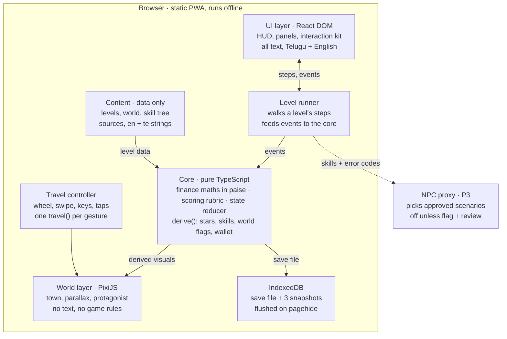
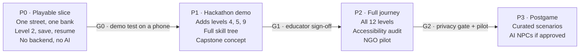

# Lifeof₹ — Technical Implementation Plan

Oct 10, 2026 · Parth

Build Lifeof₹ as a static, offline-capable web app (PWA). A PixiJS canvas draws the pixel-art town. A React DOM layer draws every lesson, form and line of text. A pure TypeScript core owns scoring, finance maths and saved state.

The P0 slice (one street, one bank, Level 2) runs with no backend and no AI. NPCs are added later without changing the core. This document turns the product plan (`plan (1).md`, 10 Oct 2026), which deliberately leaves architecture open, into concrete engineering decisions.

## Plan review

The product plan is strong on what to build and what not to trade away. Its gaps are all places where engineering choices interact, and each is closed in a later section.

| Area | What the plan gets right | Gap | How this doc closes it |
| --- | --- | --- | --- |
| Scope | P0–P3 ladder, AI strictly optional, explicit scope fence | No timeline or team size. 12 levels need ~11 bespoke interactions | Reusable interaction kit; P1 targets 4 levels (2, 4, 5, 9) |
| Architecture | Leaves the stack open on purpose | Renderer, text, scaling and offline choices constrain each other | Two-layer architecture, pure core (Architecture) |
| Motion | Concrete brief: one gesture = one destination, 0.7–1.1 s, reduced motion | No input model for wheel bursts, trackpad inertia or open panels | Gesture state machine with a travel lock (Travel controller) |
| Language | Signs and labels rendered as app text, not baked into images | Canvas text cannot shape Telugu reliably | All readable text lives in the DOM, never in the canvas |
| Privacy | Treated as a release blocker; data minimisation | No identity model. Learners are under 18, which India's DPDP Act 2023 treats as children | No personal data at all: NGO-issued pseudonymous codes, local-first storage |
| Scoring | Clear 0–3 star rubric | Written as prose, not computable | Deterministic scoring function over attempt events |
| Learning data | Keeps the first attempt; logs error categories | No record format | Append-only attempt records with coded error categories |
| Accuracy | Names RBI, NPCI, SEBI, NCFE for review | No mechanism to enforce review | Each factual claim in content carries a source ID and review stamp; CI fails without them |
| AI tooling | Lean tool set with named fallbacks | Accounts, costs and output drift unverified | Art bible + automated asset lint gate, independent of which generator is used |

The plan's own demo definition (Section 15, "When the demo is ready") is adopted as the P0 acceptance test.

## System architecture

The app is two rendering layers over one pure core: PixiJS draws the town, React draws everything a student reads or taps, and `core/` decides every star, number and world change.



Arrows show what each part feeds; dashed links are optional, later-phase services. Three rules keep the shape:

- The canvas never holds text or game rules, so Telugu, screen readers and scoring never depend on it.
- The core has no DOM, network or AI dependency; it runs identically in tests and offline.
- Everything that leaves the device (dashed) is optional and arrives in P3 or later.

## Tech stack and repository layout

One TypeScript codebase, built by Vite, deployed as static files. Everything below runs in the browser; there is no server piece.

| Layer | Choice | Why | Rejected alternative |
| --- | --- | --- | --- |
| Language and build | TypeScript (strict), Vite, pnpm | Fast dev loop; one language for core, UI and tools | — |
| World renderer | PixiJS v8 | Small 2D WebGL renderer with sprite batching and nearest-neighbour scaling; no engine features we would fight | Phaser 3: its scene, input and text systems duplicate what React and our travel controller do |
| UI layer | React 19, CSS Modules, design tokens as CSS custom properties | Real DOM text for Telugu shaping, screen readers, focus and forms | Canvas-drawn UI: inaccessible, poor Indic text |
| Animation | GSAP 3 (incl. Flip) | One timeline clock drives both the Pixi camera and DOM morphs (phone → UPI panel) | Motion (framer-motion): DOM only |
| State | Zustand store over a pure reducer in `core/` | Reducer is unit-testable with no DOM; store gives React bindings | Redux Toolkit: more ceremony for no gain here |
| Validation | Zod | Same schemas validate level content and saves | — |
| Local persistence | IndexedDB via Dexie | Survives tab close; works offline; transactional | localStorage: size-limited, synchronous, easy to corrupt |
| Offline | vite-plugin-pwa (Workbox) | Precache app shell + first level; lazy-cache later levels | — |
| i18n | i18next with ICU messages; self-hosted Noto Sans + Noto Sans Telugu | English and Telugu from day one; no font CDN calls | — |
| Asset packing | AssetPack (PixiJS) + sharp | Atlases, WebP/PNG variants, content-hashed manifest | Hand-made sprite sheets |
| Tests | Vitest + fast-check, Playwright, @axe-core/playwright | Unit/property tests for maths and scoring; device-sized e2e and screenshot diffs; automated a11y | — |
| Hosting | Static host (Cloudflare Pages or Vercel), strict CSP | No server to secure; no third-party scripts | — |

Proposed layout. The rule that matters: `core/` imports nothing from the DOM, Pixi or React, so every lesson rule and calculation is testable in isolation.

```
src/
  core/                 pure TS — no DOM, no Pixi, no React
    finance/            money.ts (integer paise), emi.ts, interest.ts, inflation.ts
    scoring/            rubric.ts, errorCategories.ts
    state/              gameState.ts, actions.ts, reducer.ts, merge.ts, migrations/
    unlocks.ts          skill-tree + world-flag rules
  content/              data only, validated by Zod
    levels/             l01-budget.level.ts … l12-capstone.level.ts
    world.ts            districts, locations, snap points
    skillTree.ts        5 branches, nodes, edges
    sources.ts          citable source registry (RBI, NPCI, SEBI, NCFE)
    locales/{en,te}/    all player-facing strings
  world/                PixiJS: stage, camera, parallax, actors, location visuals
  input/                travelController.ts — gesture state machine
  level-runner/         binds content → UI → core for one level
  ui/                   React: HUD, panels, dialogue, results, skill tree, settings
    interactions/       reusable financial interaction kit
  persistence/          db.ts (Dexie), saveQueue.ts
  platform/             viewport, reduced motion, audio, PWA
art/
  bible/                art-bible.md, palette.json, reference scenes
  raw/                  generator output (Git LFS)
  approved/             frozen, lint-passed assets
tools/
  asset-lint/           grid, palette, alpha, seams, frame checks
  content-lint/         source stamps, i18n coverage, schema checks
tests/
  e2e/  visual/
```

## Detailed component design

Each component below has one owner module and talks to the others only through typed events and the game state.

### World renderer (`world/`)

The town is authored on a 16 px tile grid at a fixed logical height of 270 px, then scaled by a whole number so pixels stay crisp on every screen.

- **Scale rule:** `s = floor(worldBandHeightDevicePx / 270)`, minimum 1. Logical width = `viewportWidthDevicePx / s`. Leftover height is filled by extending the sky and pavement colours, never by fractional scaling.
- **World band:** full height on landscape and desktop; about 60% of the height on portrait phones, leaving the lower area for the dialogue sheet and HUD. A 390×844 phone at 3× DPR gets s = 5 and ~234 logical px of width: one focal building plus neighbours' edges. A 1920×1080 desktop gets s = 4 and 480 px: four to five buildings visible.
- **Sprite size:** protagonist 32×48 logical px, so about 80 CSS px tall on that phone.
- **Layers and parallax factors:** sky 0.1, far skyline 0.3, mid trees and wires 0.6, street and buildings 1.0, foreground props 1.2. Camera and every layer offset are rounded to whole logical pixels to stop shimmer.
- **Locations:** `content/world.ts` lists snap points `{ id, x, district, doorX, buildingAsset }`. Districts (urban, high street, rural-connected) are contiguous runs on one street, not separate maps.
- **Protagonist states:** idle, walk, run, arrive, interact, with facing set by `scale.x = ±1`. Travel duration scales with distance, clamped to 0.7–1.1 s; hops longer than two buildings use the run cycle.
- **World change is derived, never stored twice:** a pure `deriveWorldVisuals(state)` maps saved flags to visual variants (bank teller greets you, home detail upgraded, bike instead of walking). The renderer diffs and applies the result, so reload always reproduces the same town.
- **Performance:** one atlas per district (≤ 2048²), next district loaded on approach; ticker paused when the tab is hidden; idle ambience reduced if frame time stays above 22 ms.

### Travel controller (`input/travelController.ts`)

A small state machine turns wheel, swipe, keyboard, button and tap input into exactly one `travel` command per deliberate gesture.

1. The page itself never scrolls: `overflow: hidden` on the body, `overscroll-behavior: none` on the root (no pull-to-refresh), `touch-action: none` on the world band.
2. **Wheel/trackpad:** deltas accumulate; once the sum reaches 60 px the controller fires one step and locks.
3. **Lock:** lasts for the travel tween, then until no wheel event has arrived for 200 ms. This absorbs trackpad inertia tails, so one flick can never skip two buildings.
4. **Swipe:** a pointer gesture of at least 40 CSS px (or 0.3 px/ms) on its dominant axis. Up or left = forward; down or right = back, so the phone's "scroll" gesture drives the street.
5. **Keyboard and buttons:** ←/→ and visible Previous/Next buttons step once; Enter opens the location you are standing at.
6. **Tap a building:** travels straight to it, even several stops away, because the target is explicit.
7. **Panel open:** the world band gets `inert` and the controller is disabled. Panels use `overscroll-behavior: contain`, so scrolling a form never moves the town.
8. **Reduced motion:** from the OS setting or the in-game toggle, travel becomes a 150 ms cross-fade and the camera cuts.
9. On arrival it emits `arrived(locationId)`; the door hotspot pulses and becomes the focused control.

All thresholds live in one config object and are tuned on a real Android phone, as the plan requires.

### Level runner and content model (`level-runner/`, `content/levels/`)

A level is data, not code. The runner walks its steps in order and hands each one to a UI component.

```ts
type LevelDef = {
  id: LevelId;                       // 'l02-bank-account'
  skillNodes: SkillNodeId[];         // lit on completion
  location: LocationId;              // where the decision happens
  steps: [
    HookStep,                        // NPC dialogue, ≤ 3 lines
    LessonStep,                      // interactive micro-lesson
    TravelStep,                      // go to `location`
    DecisionStep,                    // { interaction: InteractionId, config, rubric }
    ConsequenceStep,                 // visual outcome + explanation
    TransferStep,                    // variant drawn from a pool, new numbers/context
  ];
  worldEffects: WorldEffect[];       // flags set on completion
  claims: ClaimRef[];                // factual statements → sources.ts
};
```

Every interaction emits the same event shape, which is what scoring and analytics consume:

```ts
type InteractionEvent =
  | { kind: 'choice'; stepId: string; correct: boolean; error?: ErrorCategory; severity?: 'minor' | 'major' | 'critical' }
  | { kind: 'hint'; stepId: string; level: 1 | 2 }
  | { kind: 'explanationOpened'; stepId: string };
```

The interaction kit covers all 12 planned levels with 9 components, so later levels are mostly new content, not new code:

| Component | Levels | What the student does |
| --- | --- | --- |
| BudgetAllocator | 1, 6, 12 | Drags fictional money into needs, wants, savings |
| DocumentInspector | 2, 8, 10 | Inspects a fictional form, payslip or policy; taps fields to answer |
| FormFiller | 2 | Completes a fictional account-opening form with safe choices |
| UpiPayment | 4 | Checks payee, amount and PIN prompt on a mock phone |
| MessageTriage | 5 | Sorts messages and calls as safe or fraud, flags warning signs |
| ReceiptInspector | 6 | Finds discount, tax and total on a receipt |
| TimeSlider | 3, 7, 11 | Moves time forward to see savings growth or price change |
| OfferComparator | 9, 10, 11 | Compares cards side by side: EMI, tenure, fees, total repaid, risk |
| ScenarioChain | 12 | Strings several kit components into one connected case |

### Scoring (`core/scoring/`)

Stars are a pure function of one attempt's events, so the same play always earns the same rating and the rubric is unit-tested.

| Event | Penalty points |
| --- | --- |
| Minor mistake (e.g. skipped a field check) | 1 |
| Major mistake (e.g. chose the loan with the higher total cost) | 2 |
| Hint, level 1 / level 2 | 0.5 / 1 |
| Opening an explanation, slow reading, retrying a step after reading | 0 |

Rules, applied in order:

1. **0 stars (Try again)** if the decision step is never completed correctly, or a critical safety error (sharing a PIN or OTP, paying a fraud request) is left unresolved.
2. Otherwise P = sum of penalty points: P = 0 → 3 stars; P ≤ 2 → 2 stars; P > 2 → 1 star.
3. A wrong first answer on the transfer step caps the result at 2 stars, since 3 stars means the idea transferred.
4. A critical safety error, even when corrected in the same attempt, caps the result at 1 star. The cap is a per-level rubric setting.

There is no time-based scoring anywhere. The "What changed my result?" review is generated from the same events: each error event maps to a review card (your choice, the safer choice, the concept, why it costs or risks money, a retry button, the skill node). Card text lives in the level's content keyed by error category.

Error categories are stable dotted codes, for example `upi.pin_to_receive`, `fraud.shared_otp`, `loan.ignored_total_cost`, `inflation.nominal_vs_real`. They are the only learning signal the app stores.

### Finance maths (`core/finance/`)

All money is stored as integer paise, so totals never drift from floating-point rounding. Every rate on screen is labelled as an assumption ("Assumption: 12% a year").

Loan EMI, with P the principal, r the monthly rate (annual rate ÷ 12) and n the number of months:

```math
E = \frac{P \, r \, (1+r)^{n}}{(1+r)^{n} - 1}
```

Total repaid = E × n + fees, and total interest = total repaid − P. OfferComparator also draws the month-by-month split of principal and interest from the same function.

Deposit growth, with m compounding periods a year (quarterly is common for Indian fixed deposits; confirm per the source used):

```math
A = P \left(1 + \frac{R}{m}\right)^{m t}
```

Inflation: a price after t years is price × (1 + i)^t, and the purchasing power of ₹1 is 1 ÷ (1 + i)^t.

Property tests (fast-check) encode the lessons themselves, so a bug that would teach the wrong thing fails CI:

- Same principal and rate, longer tenure → lower EMI **and** higher total interest.
- Total repaid ≥ principal for any non-negative rate and fee.
- Positive inflation → the same rupee amount buys strictly less each year.
- Integer-paise results match a high-precision reference within 1 paisa.

### Game state and persistence (`core/state/`, `persistence/`)

The saved state is small and canonical: the attempt log, settings and current position. Stars, skills, world flags and the fictional wallet are recomputed from it.

```ts
type SaveFile = {
  schemaVersion: number;
  learner: { localId: string };                        // random UUID; never a name
  settings: { locale: 'en' | 'te'; reducedMotion: 'system' | boolean; muted: boolean; textScale: 1 | 1.25 | 1.5 };
  position: { locationId: LocationId; inLevel?: { levelId: LevelId; stepIndex: number; events: InteractionEvent[] } };
  attempts: AttemptRecord[];                          // append-only
};

type AttemptRecord = {
  id: string; levelId: LevelId; contentVersion: string;
  startedAt: string; endedAt: string;
  stars: 0 | 1 | 2 | 3; errors: ErrorCategory[]; hints: number;
  worldChoices: Record<string, string>;               // e.g. { vehicle: 'bicycle' }
};

const derive = (save: SaveFile) => ({
  bestStars, firstStars,            // max / earliest attempt per level
  skills, unlockedLocations,        // from completed levels
  worldFlags, wallet,               // from worldChoices, replayed in order
});
```

- **When it saves:** every state change is written to IndexedDB in a transaction, debounced to 300 ms, and flushed immediately on `visibilitychange` (hidden) and `pagehide`. Mid-level progress (`inLevel`) is saved too, so closing the tab resumes at the same step.
- **Corruption guard:** three rolling snapshots. A save that fails Zod validation after migration is moved to a quarantine store and the last good snapshot loads.
- **Migrations:** numbered functions from each `schemaVersion` to the next, tested against fixture saves from every released version.
- **Shared phones:** the start screen lists local players by an avatar and a generated fictional name ("Blue Kite"), with Switch player and Remove from this device. No real names are asked for.

### Content, language and accuracy (`content/`, `tools/content-lint/`)

Every player-facing string and every factual claim is data that a reviewer can check, and CI refuses content that skips review.

- **Strings:** i18next keys in `locales/en` and `locales/te`. CI fails if an English key has no Telugu entry; untranslated keys fall back to English with a dev-only marker.
- **Telugu layout:** Noto Sans Telugu at a taller line height. Playwright runs every key screen in Telugu and in a pseudo-locale that pads strings by 40% to catch clipping.
- **Claims registry:** `sources.ts` lists each source `{ id, publisher, title, url, retrievedOn }` (RBI, NPCI, SEBI, NCFE). Each level lists its claims `{ textKey, sourceIds, reviewerRole, reviewedOn }`. content-lint fails on a claim with no source or no review stamp.
- **Sensitive claims flagged in the plan** (minors' accounts and KYC, UPI PIN rules, loan costs, insurance coverage, investment risk) need an NGO educator sign-off before the level ships.
- **Content version:** a hash of each level's content is stored on every attempt, so learning data compares like with like after edits.

### Asset pipeline (`art/`, `tools/asset-lint/`)

Generated art enters the game only through an automated lint gate, whichever generator produced it.

1. **Art bible in the repo:** `palette.json` (the exact colour list), 16 px grid, 48 px character height, outline and shading rules, approved reference scenes, rejected examples.
2. **Generate:** PixelLab via MCP (or a substitute) writes to `art/raw/<family>/`. Each file gets a sidecar `{ tool, toolVersion, prompt, referenceIds, licence, date }`.
3. **Lint**, failing the asset on any of:
   - size not on the 16 px grid, or sprite frames of unequal size;
   - semi-transparent pixels (alpha must be 0 or 255);
   - colours outside `palette.json`;
   - repeating tiles whose left and right edge columns do not match (seams);
   - feet baseline or body height drifting more than 1 px between animation frames;
   - a missing licence field in the sidecar.
4. **Approve:** passing assets are copied to `art/approved/` with their lint report. A contact-sheet tool renders the plan's aesthetic acceptance scene (bank, kirana, market, player, NPC, one panel) at phone size for the single human sign-off.
5. **Build:** AssetPack packs approved assets into per-district atlases with a content-hashed manifest, including per-frame opaque and facade ground baselines. The renderer consumes these values rather than scanning atlas pixels at runtime.

Sign text, Telugu labels and numbers are never baked into art; they are DOM or bitmap-font overlays positioned from `world.ts`.

### Privacy and security

The app stores nothing off the device, which satisfies the privacy gate by construction.

| Data | Where it lives | Leaves the device? |
| --- | --- | --- |
| Code-to-student mapping | NGO's offline class list | Never uploaded |
| Names, phone, email, roll numbers, real financial data | Nowhere | Never collected |
| Free text from students | None: fictional forms use pickers and pre-filled fictional values | — |

- **Browser hardening:** strict CSP (`default-src 'self'`), self-hosted fonts, no analytics, ads or third-party SDKs. Error screens show no state; the service worker never caches non-app responses.
- **Automated release checks:** an e2e test records all network requests and fails on any origin other than the app's own.

### Optional AI NPCs (P3, behind a feature flag)

The model only picks from verified content and writes a few lines of flavour; it never scores, changes money or states facts.

- **Server-side proxy only;** no keys in the client. Disabled until the privacy review in the plan is done.
- **Input:** completed skills, the top 3 error categories, difficulty, locale and location. No IDs, codes or raw interactions.
- **Output (schema-validated):** one `scenarioId` from the approved list, plus up to 3 dialogue lines. Lines mentioning rates, product names or words like "guaranteed" are rejected.
- **Fallback:** on timeout (3 s), invalid output or any error, a deterministic rule-based picker chooses the scenario. That picker is the P2 postgame, so the AI only ever adds variety.
- The chosen scenario runs in the existing interaction kit, scored by the same rubric.

## Implementation phases and tasks

Work runs in four phases, each closed by a gate; P0 is done when the demo journey test passes on a real phone. Phase lengths stay open until the deadline and team size are known.



Each gate must pass before the next phase starts, and nothing from a later phase is started early.

### P0 — Playable slice

Ordered so the riskiest parts, art direction and swipe feel, are proven first. Level 2 is the slice because the plan's Prompt E specifies a banking lesson.

- [ ] Scaffold: Vite + strict TS, ESLint, Vitest, Playwright projects, GitHub Actions CI, test mode
- [ ] Art direction: 3 directions on the same test scene → one human pick → art bible committed
- [ ] Asset kit for one urban-to-rural-connected stretch: home, bank, kirana, 2 filler facades, street tiles, protagonist cycles, one NPC, all passing asset-lint
- [ ] World renderer: scale rule, parallax, camera, snap points
- [ ] Travel controller and bank entry transition, tuned on a real Android phone
- [ ] Core: money, interest, scoring rubric, save schema, `derive`, Dexie persistence with mid-level resume
- [ ] UI family from pen.dev or Stitch frames → design tokens; HUD, dialogue sheet, panel shell, results, skill tree
- [ ] Level 2 content (identity and bank account) with FormFiller and DocumentInspector; claims sourced and educator-reviewed
- [ ] World change: the teller recognises the player after Level 2
- [ ] Demo journey test green on all three viewports

### P1 — Hackathon demo

Levels 4, 5 and 9 cover the plan's two emphasised risks, fraud and loan costs, and levels 4 and 5 share the phone shop.

- [ ] UpiPayment, MessageTriage and OfferComparator components
- [ ] Levels 4 (UPI), 5 (fraud) and 9 (loans), with one clear negative borrowing outcome
- [ ] A return visit that remembers an earlier choice (a fraud warning-sign callback inside Level 9's offer)
- [ ] Complete skill-tree screen and replay-to-improve
- [ ] Capstone centre concept behind the branding flag
- [ ] Telugu for all P1 strings
- [ ] If capacity allows: an on-device "Show my teacher" summary of stars per skill, no server

### P2 — Full journey and pilot

- [ ] Remaining 8 levels on the kit, adding BudgetAllocator, ReceiptInspector, TimeSlider and ScenarioChain
- [ ] High-street and remaining district art through the same lint gate
- [ ] Offline hardening, accessibility audit
- [ ] Pilot with NGO students, collecting the plan's success measures

### P3 — Postgame

- [ ] Curated, rule-picked postgame scenarios at familiar buildings
- [ ] AI NPC proxy behind its flag, after the privacy review

## Testing, quality gates and demo

The plan's demo definition becomes an automated Playwright test that must pass on phone and desktop sizes before any new level starts. Everything else in this table runs in CI on every pull request unless noted.

| Layer | Tool | What it proves |
| --- | --- | --- |
| Unit and property | Vitest + fast-check | Finance maths, scoring rubric, `derive`, save migrations and merge are correct |
| Content lint | content-lint | Level schemas valid; every claim sourced and review-stamped; Telugu coverage complete |
| Asset lint | asset-lint (on art changes) | Grid, palette, alpha, seams, frame alignment, licence sidecar |
| Component | Vitest + Testing Library | Each interaction-kit component emits the right events for right and wrong answers |
| End to end | Playwright: 360×740 touch, 412×915 touch, 1440×900 desktop | The demo journey works on each size (script below) |
| Visual regression | Playwright `toHaveScreenshot` in test mode | Key screens match approved references; no clipped forms or blurry scaling |
| Accessibility | @axe-core/playwright; keyboard-only and reduced-motion runs | No axe violations; level playable with keyboard alone and with motion off |
| Privacy | Network allowlist test | No request leaves for an origin other than the app's own |
| Performance | Lighthouse CI (mobile) + an in-page FPS probe under 4× CPU throttle | Initial JS ≤ 250 KB gzipped, first-level assets ≤ 1.5 MB, LCP ≤ 2.5 s on simulated 4G, ≥ 45 fps during travel |
| Real device | Weekly on a budget Android phone; NGO student playtests from P1 | Swipe feel, readability and resume on real hardware |

**Test mode** (`?test=1`) makes screenshots deterministic: fixed random seed, Pixi ticker stepped manually, GSAP timelines jumped to their end frames, ambience off.

**Demo journey test**, taken directly from the plan:

1. Fresh profile; swipe once → the player walks to the next building, never two.
2. Arrive at the bank, enter, complete the Level 2 lesson.
3. Make the scripted mistake → result shows 2 stars and the matching review card.
4. Retry → 3 stars; best stars = 3, first attempt still recorded as 2.
5. Skill-tree node lit; bank teller variant visible in the town.
6. Reload the page → same location, stars, skill and town change.
7. Assert no network request left the app's own origin.

## Risks, open questions and mitigations

The two risks most likely to sink the demo are art drift and swipe feel, so both are tackled in the first days of P0, not at the end.

| Risk | Mitigation |
| --- | --- |
| Generated art drifts in style between asset families | Reference-locked generation, asset-lint gate, P0 limited to one street stretch |
| Swipe/scroll feels wrong on Android Chrome (address bar, inertia) | Page never scrolls; travel controller tuned on a real phone in week one |
| Telugu text clips or reads badly | DOM text only, Telugu and padded pseudo-locale screenshots, NGO translator review |
| A financial claim is wrong (minors' accounts, KYC, UPI) | Claims registry with sources; educator sign-off gates each level |
| PixelLab or pen.dev access, cost or licence terms block work | Pipeline is generator-agnostic; Stitch as UI fallback; placeholder art keeps code unblocked |
| Scope creep toward 12 levels before polish | P1 fixed at 4 levels; new levels mostly reuse the interaction kit |
| Vanguard branding approval arrives late | Neutral "Financial Futures Centre" placeholder behind a config flag |
| Low-end phones drop frames | Integer scaling, per-district atlases, adaptive ambience, FPS budget in CI |

Open questions that change the plan:

- [ ] What is the hackathon deadline and team size? This sets each phase's length.
- [ ] Who translates and reviews Telugu, and is Hindi or Urdu needed?
- [ ] pen.dev or Google Stitch as the single UI design tool?
- [ ] Has Vanguard approved its name and branding for the capstone?
- [ ] Which NGO educator signs off financial content, and how fast can they turn around a level?
